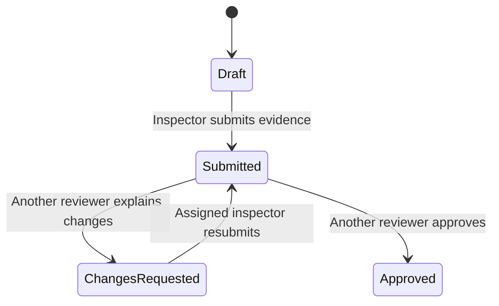

# AssetInspect architecture

A small Django monolith keeps the complete inspection workflow understandable. SQLite stores records and Django's local filesystem storage holds normalized photographs. Templates and local static assets render pages; the SVG editor is the only substantial browser-side state. No external service is required at runtime.

## Domain and access

`Asset → Inspection → Photograph → Annotation`. An annotation also references its inspection to enforce a unique per-inspection finding reference. Its model validation rejects mismatched photographs, non-finite coordinates, non-positive area, and rectangles outside the unit square. The inspector foreign key is assigned from the authenticated request, never accepted from browser input. Foreign keys protect users/assets referenced by saved records.

Assets are workspace-wide metadata visible to either role. Inspection visibility is narrower: Inspectors see their own; Reviewers see non-drafts. Edit access requires the Inspector role, matching ownership, and Draft or Changes Requested state. Review access requires the Reviewer role, Submitted state, and a different assigned inspector. Superusers have broad visibility but cannot bypass the independent-review rule for their own inspection. Admin evidence records are read-only.

Object checks apply equally to HTML pages, POST endpoints, images, and PDF/CSV downloads. All mutations use POST and CSRF. User strings remain escaped in templates; PDF text is escaped before it enters ReportLab's paragraph markup. CSV neutralizes formula-leading fields, including whitespace-prefixed formulas. Media has no public route and authenticated image responses prohibit shared caching.

## State and concurrency

Submission needs at least one photograph. When there are no findings, an explicit supplied-photographs-only no-defect confirmation is required. Adding a finding clears a prior confirmation. Submitted and Approved inspections cannot be edited. Asset metadata associated with a locked inspection also cannot be edited through the application, preserving its report context.

State transitions use database transactions, row locking where supported, and a conditional update on version/status. Each edit increments the version. Old review/submission tabs fail instead of making duplicate decisions or approving a different version. SQLite has limited write concurrency; PostgreSQL is a future production choice. Application history is append-only, with events for creation, edits, uploads, annotation changes/deletions, submission, and review. Admin disallows audit mutation. Direct privileged database access is outside this guarantee.

## Image lifecycle

The upload form validates a complete batch before saving any image. It checks encoded size, actual JPEG/PNG format, dimensions, pixel count, frame count, and Pillow verification. EXIF orientation is normalized and the decoded RGB image is re-encoded to JPEG, stripping original metadata and active/arbitrary file content. Storage names use UUIDs. The original filename is escaped metadata, never a path. On photograph deletion, related findings are removed, an event is retained, and storage deletion runs after the transaction commits.

The editor stores `{x, y, width, height}` as fractions of the image, so resizing changes presentation rather than stored geometry. Pointer capture supports mouse/touch, and explicit normalized numeric fields offer keyboard entry. Finding details are saved by ordinary CSRF-protected form submissions. Existing saved rectangles are serialized with Django's `json_script`; browser text uses `textContent`.

## Reports

PDFs read saved records, draw severity-colored numbered rectangles with Pillow, and compose an A4 document with ReportLab. Images are scaled to remain readable, findings flow over page breaks, and page numbers and the demonstration disclaimer are included. Non-approved records receive `DRAFT — NOT APPROVED`. The report includes complete review/audit history, not just the latest decision. The HTML preview uses the same persisted coordinates; the downloadable PDF contains its own annotated image pixels.

## Configuration and validation

The secret key is required from the environment or ignored `.env`; no real key/password is committed. The safe local initializer uses exclusive file creation. Debug defaults off, hostnames are explicit, and non-debug mode enables secure cookies. The explicit local seed command generates marked synthetic images and preserves user edits/passwords on repetition.

The Django integration suite uses isolated media and database state and tests access boundaries, invalid inputs, workflow invariants, exports, and demo idempotence. The optional Playwright test exercises the real inspector/reviewer UI and verifies normalized alignment across desktop/mobile sizes, touch redraw, preserved review history, and actual downloaded PDF text. CI runs the non-browser suite on Python 3.12.

## Optional Vercel testing mode

`vercel.json` registers the native Django framework/build command. The explicit `ASSETINSPECT_VERCEL_DEMO=1` setting builds a separate synthetic database and photograph template; it never migrates or uploads local user data. On a cold start the WSGI entrypoint copies that template atomically into instance-local temporary storage. Native Vercel static collection serves CSS/JS separately, while private evidence remains behind authenticated application endpoints. Exact system-provided deployment hostnames, proxy HTTPS handling, secure cookies, and signed-cookie sessions support seeded sample logins across instances. Mutations remain temporary and instance-local; the UI warns about resets/inconsistency. This is a disposable test mode, not shared persistent hosting. See DEPLOYMENT.md for credentials, limits, and redeployment steps.
